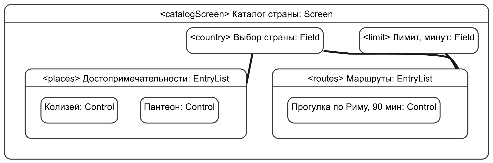
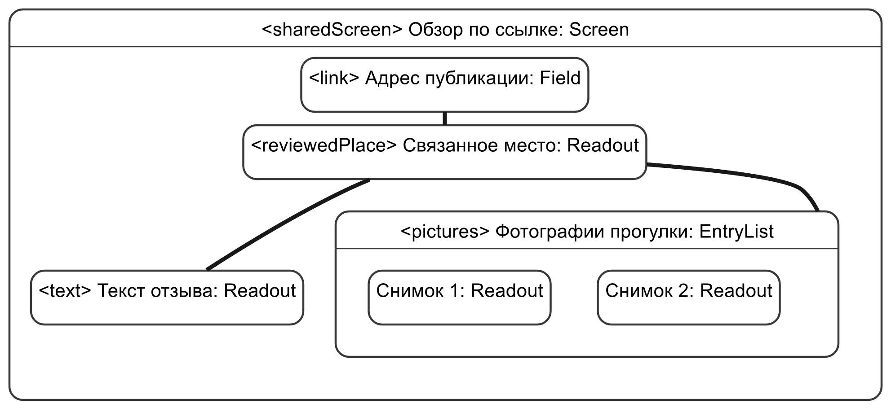

# Спецификация требований к ПО

Для программы «Электронный путеводитель»

Версия 0.9

Подготовил Юденко Е. А., гр. 434701

БГУИР, ФКСиС, кафедра ЭВМ

2026-11-27

## Оглавление

<!-- TOC -->
* [1. Введение](#1-introduction)
  * [1.1 Назначение документа](#11-document-purpose)
  * [1.2 Область применения продукта](#12-product-scope)
  * [1.3 Определения, акронимы и сокращения](#13-definitions-acronyms-and-abbreviations)
  * [1.4 Ссылки](#14-references)
  * [1.5 Обзор документа](#15-document-overview)
* [2. Обзор продукта](#2-product-overview)
  * [2.1 Перспектива продукта](#21-product-perspective)
  * [2.2 Функции продукта](#22-product-functions)
  * [2.3 Ограничения продукта](#23-product-constraints)
  * [2.4 Характеристики пользователей](#24-user-characteristics)
  * [2.5 Допущения и зависимости](#25-assumptions-and-dependencies)
  * [2.6 Распределение требований](#26-apportioning-of-requirements)
* [3. Требования](#3-requirements)
  * [3.1 Внешние интерфейсы](#31-external-interfaces)
    * [3.1.1 Пользовательские интерфейсы](#311-user-interfaces)
    * [3.1.2 Аппаратные интерфейсы](#312-hardware-interfaces)
    * [3.1.3 Программные интерфейсы](#313-software-interfaces)
  * [3.2 Функциональные требования](#32-functional)
  * [3.3 Качество обслуживания](#33-quality-of-service)
    * [3.3.1 Производительность](#331-performance)
    * [3.3.2 Безопасность](#332-security)
    * [3.3.3 Надёжность](#333-reliability)
    * [3.3.4 Доступность](#334-availability)
    * [3.3.5 Наблюдаемость](#335-observability)
  * [3.4 Соответствие стандартам](#34-compliance)
  * [3.5 Проектирование и реализация](#35-design-and-implementation)
    * [3.5.1 Установка](#351-installation)
    * [3.5.2 Сборка и поставка](#352-build-and-delivery)
    * [3.5.3 Распределение](#353-distribution)
    * [3.5.4 Сопровождаемость](#354-maintainability)
    * [3.5.5 Повторное использование](#355-reusability)
    * [3.5.6 Переносимость](#356-portability)
    * [3.5.7 Стоимость](#357-cost)
    * [3.5.8 Сроки](#358-deadline)
    * [3.5.9 Доказательство концепции](#359-proof-of-concept)
    * [3.5.10 Управление изменениями](#3510-change-management)
  * [3.6 ИИ/МО](#36-aiml)
* [4. Верификация](#4-verification)
* [5. Приложения](#5-appendixes)
<!-- TOC -->

## История изменений

| Name | Date | Reason For Changes | Version |
|---|---|---|---|
| Е. А. Юденко | 2026-11-05 | Первичная фиксация темы, границ продукта и требований для обсуждения | 0.1 |
| Е. А. Юденко | 2026-11-21 | Синхронизация требований и критериев приёмки с разделом 3.1 отчёта | 0.2 |
| Е. А. Юденко | 2026-11-21 | Уточнены назначение и приоритеты первого выпуска по итоговому отчёту | 0.3 |
| Е. А. Юденко | 2026-11-21 | Добавлены обзоры посетителей, обмен ссылками, фильтр времени и планы по геолокации | 0.4 |
| Е. А. Юденко | 2026-11-21 | Восстановлены исходные четыре требования и критерии приёмки. Идеи развития перенесены в задачи проекта | 0.5 |
| Е. А. Юденко | 2026-11-21 | Структура разделов 2 и 3 приведена к шаблону кафедры | 0.6 |
| Е. А. Юденко | 2026-11-27 | Расширен реестр требований, добавлены проверки и графические приложения | 0.7 |
| Е. А. Юденко | 2026-11-27 | Сверены категории требований и уточнены критерии приёмки | 0.8 |
| Е. А. Юденко | 2026-11-27 | Оформление по образцу SRS, уточнение связей между требованиями, проверками и макетами | 0.9 |

---

## 1. Введение

Спецификация описывает настольное приложение «Электронный путеводитель» на C++ для самостоятельного планирования прогулок по незнакомым городам.

### 1.1 Назначение документа

Документ фиксирует требования, границы продукта и критерии приёмки. Заказчик использует его для согласования очередей, разработчик – для реализации, а проверяющий – для подготовки сценариев.

### 1.2 Область применения продукта

Каталог охватывает страны, внесённые в базу. Турист выбирает страну, изучает её места и открывает готовые прогулки. В развитии авторы добавляют собственные места, маршруты и отзывы, а читатели выбирают прогулку по времени и открывают обзоры по ссылке.

- **ID:** BR-03
- **Title:** Самостоятельная прогулка
- **Statement:** Цель издателя – сделать путеводитель источником для самостоятельного планирования экскурсий по незнакомым городам.
- **Rationale:** Туристу проще решить, с чего начать знакомство с городом.
- **Acceptance Criteria:** По материалам путеводителя турист без подсказок называет начало прогулки и объясняет порядок остановок.
- **Verification Method:** Demonstration
- **More Information:** Основа · Путеводитель

### 1.3 Определения, акронимы и сокращения

| Term | Definition |
|---|---|
| Страна | Запись каталога, содержащая название страны и связанные с ней достопримечательности и маршруты. |
| Достопримечательность | Объект интереса, относящийся к одной стране в базе данных. |
| Маршрут | Упорядоченный набор достопримечательностей, предлагаемый для посещения. Это определение подлежит подтверждению заказчиком. |
| Обзор | Опубликованный отзыв посетителя, связанный с конкретным местом или маршрутом и доступный по ссылке. |
| Длительность | Оценка автора в минутах, используемая при выборе прогулки. |
| База данных | Постоянное хранилище записей о странах, достопримечательностях и маршрутах; прототип использует SQLite. |
| SRS | Спецификация требований к программному обеспечению. |
| SysML v2 | Язык моделирования систем, использованный для графической части работы. |

### 1.4 Ссылки

1. [Отчёт по разработке требований](../lab3/lab3.docx).
2. [Сборка и демонстрационный прототип](../project/README.md).
3. [Исходники моделей SysML v2](../lab3/sysml/models/).
4. [Шаблон спецификации кафедры](srs-template.md).

### 1.5 Обзор документа

Раздел 2 описывает продукт, роли и очереди. Раздел 3 содержит карточки требований, раздел 4 связывает их с проверками. Модели, макеты и словарь данных приведены в разделе 5.

---

## 2. Обзор продукта

### 2.1 Перспектива продукта

Настольный клиент читает каталог из локальной SQLite. В расширении для передачи обзоров между пользователями предусмотрен общий источник опубликованных материалов. Карта и определение местоположения относятся к следующему этапу.

### 2.2 Функции продукта

1. Загрузка стран, мест и прогулок из базы.
2. Просмотр маршрута с остановками в заданном порядке и описанием места.
3. Отбор маршрутов выбранной страны по лимиту времени.
4. Добавление своих мест и маршрутов, публикация отзывов с фотографиями.
5. Передача ссылки и открытие обзора другим туристом.
6. Добавление метки на карту и запрос местоположения с разрешения пользователя.

### 2.3 Ограничения продукта

1. Настольный прототип предназначен для Windows и написан на C++.
2. Доступные страны и материалы определяются содержимым каталога.
3. Длительность в минутах указывает автор маршрута.
4. Публикация обзоров и картографические функции распределены по очередям в пункте 2.6.

### 2.4 Характеристики пользователей

| Роль (класс) | Характеристики и уровень подготовки | Уровень доступа и цели в системе |
|---|---|---|
| Турист-читатель | Пользуется путеводителем при планировании поездки | Выбирает страну и прогулку, знакомится с местами, открывает полученный обзор |
| Турист-автор | Посетитель, знакомый с местом или маршрутом | В расширении добавляет материалы, пишет отзыв с фото и передаёт ссылку |
| Издатель | Заказчик продукта, определяет назначение каталога | Согласует наполнение, очереди развития и критерии приёмки |

### 2.5 Допущения и зависимости

- Для просмотра базового каталога нужен доступ к локальному файлу SQLite.
- Для открытия ссылки в другом клиенте нужен доступ к источнику опубликованных обзоров.
- Определение местоположения зависит от разрешения пользователя.

### 2.6 Распределение требований

| Подсистема / Релиз | Входящие требования |
|---|---|
| **Основа.** Локальный каталог и просмотр прогулок | [`BR-03`](#br-03), [`REQ-INT-001`](#req-int-001), [`REQ-INT-002`](#req-int-002), [`REQ-FUNC-002`](#req-func-002), [`REQ-FUNC-001`](#req-func-001), [`REQ-FUNC-003`](#req-func-003), [`REQ-FUNC-004`](#req-func-004), [`REQ-REL-001`](#req-rel-001) |
| **Развитие.** Фильтр времени, пользовательские материалы, обзоры и обмен | [`REQ-INT-003`](#req-int-003), [`REQ-FUNC-005`](#req-func-005), [`REQ-FUNC-006`](#req-func-006), [`REQ-FUNC-007`](#req-func-007), [`REQ-FUNC-008`](#req-func-008), [`REQ-FUNC-009`](#req-func-009), [`REQ-REL-002`](#req-rel-002) |
| **Следующий этап.** Карта и геолокация | [`REQ-FUNC-010`](#req-func-010), [`REQ-SEC-001`](#req-sec-001) |
| **На согласование.** Клавиатурное управление, время отклика и диагностика | [`REQ-INT-004`](#req-int-004), [`REQ-PERF-001`](#req-perf-001), [`REQ-OBS-001`](#req-obs-001) |

---

## 3. Требования

### 3.1 Внешние интерфейсы

Интерфейсы описаны по типу взаимодействия пользователя, устройства и программы с каталогом.

#### 3.1.1 Пользовательские интерфейсы

- **ID:** REQ-INT-001
- **Title:** Контекст маршрута
- **Statement:** При просмотре маршрута пользователь должен одновременно видеть название прогулки и страну, к которой она относится.
- **Rationale:** Название страны помогает ориентироваться без возврата к началу поиска.
- **Acceptance Criteria:** При просмотре прогулки по Риму одновременно видны название маршрута и страна «Италия».
- **Verification Method:** Inspection
- **More Information:** Основа · Карточка маршрута

- **ID:** REQ-INT-002
- **Title:** Пустая выборка
- **Statement:** Если у страны есть места, а прогулок нет, область маршрутов показывает сообщение. Список мест остаётся видимым.
- **Rationale:** Туристу видно, что каталог успешно загружен, даже если список прогулок пуст.
- **Acceptance Criteria:** У страны с одним местом без прогулок видны место и сообщение об отсутствии маршрутов.
- **Verification Method:** Inspection
- **More Information:** Основа · Каталог

- **ID:** REQ-INT-003
- **Title:** Длительность прогулки
- **Statement:** Заданная длительность видна в карточке прогулки в минутах.
- **Rationale:** Читатель понимает значение оценки и единицу измерения.
- **Acceptance Criteria:** У прогулки с длительностью 90 на экране есть подпись «90 минут».
- **Verification Method:** Inspection
- **More Information:** Развитие · Карточка маршрута

- **ID:** REQ-INT-004
- **Title:** Выбор с клавиатуры
- **Statement:** Страну и маршрут можно выбрать с клавиатуры. Фокус выделяется на экране.
- **Rationale:** Основной сценарий доступен при отсутствии мыши.
- **Acceptance Criteria:** Клавишами Tab, стрелками и Enter выбрать страну и открыть маршрут. Фокус виден на каждом шаге.
- **Verification Method:** Demonstration
- **More Information:** Предложение · Каталог · Клавиатурная доступность интерфейса · Прежний ID: REQ-ACCESS-001

#### 3.1.2 Аппаратные интерфейсы

Настольный клиент использует экран и обычные средства ввода. Требования к специализированным устройствам не установлены.

#### 3.1.3 Программные интерфейсы

Прототип читает [локальную базу SQLite](../project/resources/catalog.sql). Контракт обмена обзорами подлежит уточнению при проектировании расширения.

### 3.2 Функциональные требования

- **ID:** REQ-FUNC-001
- **Title:** Страны из базы
- **Statement:** При загрузке каталога программа формирует список стран из записей базы.
- **Rationale:** Редакция может расширять охват постепенно.
- **Acceptance Criteria:** Загрузить две страны, добавить третью и повторить загрузку. Список в каждом случае совпадает с записями базы.
- **Verification Method:** Test
- **More Information:** Основа · Каталог

- **ID:** REQ-FUNC-002
- **Title:** Смена страны
- **Statement:** При выборе страны программа должна обновить списки достопримечательностей и маршрутов. В обоих списках должны остаться только записи выбранной страны.
- **Rationale:** Турист видит, какие места можно посетить в выбранной стране и какие прогулки по ним уже подготовлены.
- **Acceptance Criteria:** После перехода с Италии на Беларусь в списках видны Верхний город и прогулка по центру Минска. Колизей и прогулка по центру Рима больше не отображаются.
- **Verification Method:** Test
- **More Information:** Основа · Каталог

- **ID:** REQ-FUNC-003
- **Title:** Порядок остановок
- **Statement:** Программа формирует последовательность остановок по возрастанию сохранённой позиции в маршруте.
- **Rationale:** Порядок определяет план прогулки.
- **Acceptance Criteria:** Поменять позиции второй и третьей остановок в тестовой базе. Открыть маршрут и сверить полученный порядок остановок с новыми позициями.
- **Verification Method:** Test
- **More Information:** Основа · Маршрут

- **ID:** REQ-FUNC-004
- **Title:** Описание места
- **Statement:** Выбор остановки открывает сведения связанной достопримечательности.
- **Rationale:** Туристу нужен контекст именно выбранной остановки.
- **Acceptance Criteria:** Для Пантеона и Колизея задать разные описания; при выборе каждой точки появляется соответствующий текст.
- **Verification Method:** Test
- **More Information:** Основа · Карточка места

- **ID:** REQ-FUNC-005
- **Title:** Подбор по времени
- **Statement:** При заданном лимите времени программа отбирает маршруты выбранной страны, длительность которых не превышает этот лимит.
- **Rationale:** Посетитель может выбрать прогулку под доступное время.
- **Acceptance Criteria:** При лимите 90 минут показаны маршруты выбранной страны на 60 и 90 минут. Маршрут на 120 минут и маршрут другой страны скрыты.
- **Verification Method:** Test
- **More Information:** Развитие · Каталог

- **ID:** REQ-FUNC-006
- **Title:** Внесение материала
- **Statement:** Программа позволяет автору сохранить описание места или прогулки с привязкой к выбранной стране.
- **Rationale:** Так посетители пополняют каталог собственными материалами.
- **Acceptance Criteria:** Создать место и прогулку. Повторно открыть записи и сверить название и страну каждой.
- **Verification Method:** Test
- **More Information:** Развитие · Редактор

- **ID:** REQ-FUNC-007
- **Title:** Публикация отзыва
- **Statement:** При публикации программа связывает отзыв с выбранной записью места или маршрута.
- **Rationale:** Читателю важно понимать предмет отзыва.
- **Acceptance Criteria:** Создать одноимённые прогулки в двух странах. Опубликовать отзыв об одной. Отзыв виден только у выбранной прогулки.
- **Verification Method:** Test
- **More Information:** Развитие · Редактор

- **ID:** REQ-FUNC-008
- **Title:** Фотографии
- **Statement:** Программа позволяет автору прикрепить к черновику отзыва несколько фотографий достопримечательности и сохранить их при публикации.
- **Rationale:** Снимки дополняют описание личным опытом.
- **Acceptance Criteria:** Прикрепить два разных снимка к черновику, опубликовать отзыв и сверить оба изображения в опубликованной записи.
- **Verification Method:** Test
- **More Information:** Развитие · Вложения

- **ID:** REQ-FUNC-009
- **Title:** Ссылка на обзор
- **Statement:** По ссылке на опубликованный обзор программа открывает именно этот обзор.
- **Rationale:** Получатель ссылки может перейти сразу к нужному отзыву.
- **Acceptance Criteria:** Открыть в другом клиенте ссылки на два разных обзора, один из которых без фотографий. По каждой ссылке видны соответствующие объект и текст.
- **Verification Method:** Test
- **More Information:** Развитие · Обмен

- **ID:** REQ-FUNC-010
- **Title:** Метка объекта
- **Statement:** Автор может поставить метку места на карте. Программа сохраняет координаты метки в записи достопримечательности.
- **Rationale:** Метка связывает обзор с конкретной точкой.
- **Acceptance Criteria:** Поставить метку в точке с известными координатами. При повторном открытии достопримечательности положение метки совпадает с выбранной точкой.
- **Verification Method:** Test
- **More Information:** Следующий этап · Карта

### 3.3 Качество обслуживания

Требования к качеству сгруппированы по производительности, безопасности, надёжности, доступности и наблюдаемости.

#### 3.3.1 Производительность

- **ID:** REQ-PERF-001
- **Title:** Время смены страны
- **Statement:** При локальной базе из 1000 мест и 100 маршрутов списки обновляются не более чем за 2 с не менее чем в 95 % переключений страны. Порог и конфигурация тестового ПК предложены для согласования.
- **Rationale:** Ограничение задаёт допустимое ожидание туриста после выбора страны.
- **Acceptance Criteria:** На указанном ПК после прогрева измерить 20 переключений от выбора страны до обновления обоих списков. Не менее 19 измерений укладываются в 2 с.
- **Verification Method:** Measurement
- **More Information:** Предложение · Каталог

#### 3.3.2 Безопасность

- **ID:** REQ-SEC-001
- **Title:** Согласие на доступ к геолокации
- **Statement:** Программа запрашивает текущее местоположение только после явного разрешения пользователя.
- **Rationale:** Турист контролирует использование своих координат.
- **Acceptance Criteria:** При отказе в доступе запрос координат отсутствует. После явного разрешения запрос выполняется.
- **Verification Method:** Test
- **More Information:** Следующий этап · Карта

#### 3.3.3 Надёжность

- **ID:** REQ-REL-001
- **Title:** Сбой загрузки
- **Statement:** Если загрузить каталог полностью не удалось, программа должна сообщить об ошибке и исключить отображение неполных данных как полного каталога.
- **Rationale:** Гость понимает, можно ли доверять увиденному.
- **Acceptance Criteria:** Проверить недоступную базу и сбой после чтения части записей. В обоих случаях видна ошибка загрузки, а частичные данные скрыты.
- **Verification Method:** Test
- **More Information:** Основа · Чтение базы

- **ID:** REQ-REL-002
- **Title:** Устойчивость публикации к сбою
- **Statement:** При сбое сохранения вложения программа сохраняет обзор в черновике. Читателю доступны только полностью опубликованные обзоры.
- **Rationale:** При отказе записи сохраняется целостность публикации.
- **Acceptance Criteria:** При сбое сохранения второго снимка у автора остаётся черновик, а обзор недоступен в другом клиенте. После успешной повторной публикации видны оба снимка.
- **Verification Method:** Test
- **More Information:** Развитие · Публикация

#### 3.3.4 Доступность

Целевой показатель доступности системы для этой редакции предстоит согласовать. Клавиатурное управление описано в п. 3.1.1.

#### 3.3.5 Наблюдаемость

- **ID:** REQ-OBS-001
- **Title:** Диагностика ошибки
- **Statement:** Диагностика при чтении базы различает недоступный файл и отсутствующую обязательную таблицу.
- **Rationale:** Разработчик может отличить ошибку открытия файла от несовместимой структуры базы.
- **Acceptance Criteria:** Запустить программу без файла базы и с открываемой базой без обязательной таблицы. В диагностике указаны разные причины.
- **Verification Method:** Test
- **More Information:** Предложение · Диагностика

### 3.4 Соответствие стандартам

Отчёт оформляется по СТП 01–2024 БГУИР. Диаграммы и макеты интерфейса строятся из текстовых моделей SysML v2.

### 3.5 Проектирование и реализация

#### 3.5.1 Установка

Среда прототипа – Windows. Рядом с исполняемым файлом размещается база каталога.

#### 3.5.2 Сборка и поставка

Сборка выполняется с помощью CMake. Порядок запуска и размещения базы приведён в [инструкции проекта](../project/README.md).

#### 3.5.3 Распределение

Основной каталог можно использовать локально. Для публикации и обмена нужен общий источник данных.

#### 3.5.4 Сопровождаемость

Данные маршрутов и порядок остановок хранятся отдельно от логики отображения.

#### 3.5.5 Повторное использование

Компонент доступа к каталогу используется при формировании списков и карточек.

#### 3.5.6 Переносимость

Поддержка иных ОС требует отдельного решения.

#### 3.5.7 Стоимость

Бюджет выпуска в рамках этой спецификации не утверждён.

#### 3.5.8 Сроки

Календарный план уточняется при проектировании.

#### 3.5.9 Доказательство концепции

Демонстрационный сценарий – смена страны, открытие маршрута и просмотр остановки.

#### 3.5.10 Управление изменениями

Изменение связывают с ID, критерием приёмки и редакцией в Git.

### 3.6 ИИ/МО

Использование ИИ и машинного обучения не предусмотрено.

---

## 4. Верификация

Статус `Planned` означает, что проверка запланирована. У предложений проверка зависит от согласования. Критерии и вспомогательные макеты указаны в `Test/Artifact Link`. Поле `Evidence` заполняется результатами проверки.

| Requirement ID | Verification Method | Test/Artifact Link | Status | Evidence |
|---|---|---|---|---|
| BR-03 | Demonstration | [Критерий приёмки](#br-03) · [Макет или модель](../lab3/sysml/01-business-goals.png) | Planned | — |
| REQ-INT-001 | Inspection | [Критерий приёмки](#req-int-001) · [Макет или модель](../lab3/sysml/08-gui-route.png) | Planned | — |
| REQ-INT-002 | Inspection | [Критерий приёмки](#req-int-002) · [Макет или модель](../lab3/sysml/07-gui-catalog.png) | Planned | — |
| REQ-INT-003 | Inspection | [Критерий приёмки](#req-int-003) · [Макет или модель](../lab3/sysml/08-gui-route.png) | Planned | — |
| REQ-INT-004 | Demonstration | [Критерий приёмки](#req-int-004) · [Макет или модель](../lab3/sysml/07-gui-catalog.png) | Planned | — |
| REQ-FUNC-002 | Test | [Критерий приёмки](#req-func-002) · [Макет или модель](../lab3/sysml/07-gui-catalog.png) | Planned | — |
| REQ-FUNC-001 | Test | [Критерий приёмки](#req-func-001) · [Макет или модель](../lab3/sysml/07-gui-catalog.png) | Planned | — |
| REQ-FUNC-003 | Test | [Критерий приёмки](#req-func-003) · [Макет или модель](../lab3/sysml/08-gui-route.png) | Planned | — |
| REQ-FUNC-004 | Test | [Критерий приёмки](#req-func-004) · [Макет или модель](../lab3/sysml/19-attraction.png) | Planned | — |
| REQ-FUNC-005 | Test | [Критерий приёмки](#req-func-005) · [Макет или модель](../lab3/sysml/17-duration-boundary.png) | Planned | — |
| REQ-FUNC-006 | Test | [Критерий приёмки](#req-func-006) | Planned | — |
| REQ-FUNC-007 | Test | [Критерий приёмки](#req-func-007) · [Макет или модель](../lab3/sysml/18-domain.png) | Planned | — |
| REQ-FUNC-008 | Test | [Критерий приёмки](#req-func-008) · [Макет или модель](../lab3/sysml/10-gui-review-photos.png) | Planned | — |
| REQ-FUNC-009 | Test | [Критерий приёмки](#req-func-009) · [Макет или модель](../lab3/sysml/21-shared-review.png) | Planned | — |
| REQ-FUNC-010 | Test | [Критерий приёмки](#req-func-010) | Planned | — |
| REQ-PERF-001 | Measurement | [Критерий приёмки](#req-perf-001) | Planned | — |
| REQ-SEC-001 | Test | [Критерий приёмки](#req-sec-001) | Planned | — |
| REQ-REL-001 | Test | [Критерий приёмки](#req-rel-001) · [Макет или модель](../lab3/sysml/04-catalog-states.png) | Planned | — |
| REQ-REL-002 | Test | [Критерий приёмки](#req-rel-002) · [Макет или модель](../lab3/sysml/05-review-flow.png) | Planned | — |
| REQ-OBS-001 | Test | [Критерий приёмки](#req-obs-001) | Planned | — |

---

## 5. Приложения

### 5.1 Контекстная диаграмма системы

[Варианты использования](../lab3/sysml/03-usecases.png) · [Бизнес-цель](../lab3/sysml/01-business-goals.png) · [Состояния каталога](../lab3/sysml/04-catalog-states.png) · [Публикация обзора](../lab3/sysml/05-review-flow.png) · [Связи данных](../lab3/sysml/18-domain.png) · [Фильтр времени](../lab3/sysml/17-duration-boundary.png) · [Распределение требований](../lab3/sysml/16-requirements-count.png).

### 5.2 Макеты пользовательского интерфейса (SysMLv2 → PNG)

Макеты построены из [модели интерфейса](../lab3/sysml/models/06-gui.sysml). [Карта переходов](../lab3/sysml/06-navigation.png).

#### Экран 1. Каталог страны

#### Экран 2. Карточка маршрута

#### Экран 3. Карточка остановки

#### Экран 4. Ошибка загрузки каталога

#### Экран 5. Редактор отзыва с фотографиями

#### Экран 6. Обзор по ссылке

### 5.3 Словарь основных сущностей данных

| Сущность | Ключевые атрибуты | Назначение |
|---|---|---|
| Страна | ID, название, описание | Группирует места и маршруты |
| Достопримечательность | ID, ID страны, название, город, описание | Точка интереса в каталоге |
| Маршрут | ID, ID страны, название, описание, длительность в расширении | Готовая прогулка |
| Остановка | ID маршрута, позиция, ID места | Задаёт порядок посещения |
| Обзор | ID и тип объекта, текст, ссылка | Публикация о месте или прогулке |
| Фотография | ID отзыва, изображение | Вложение посетителя к отзыву |
