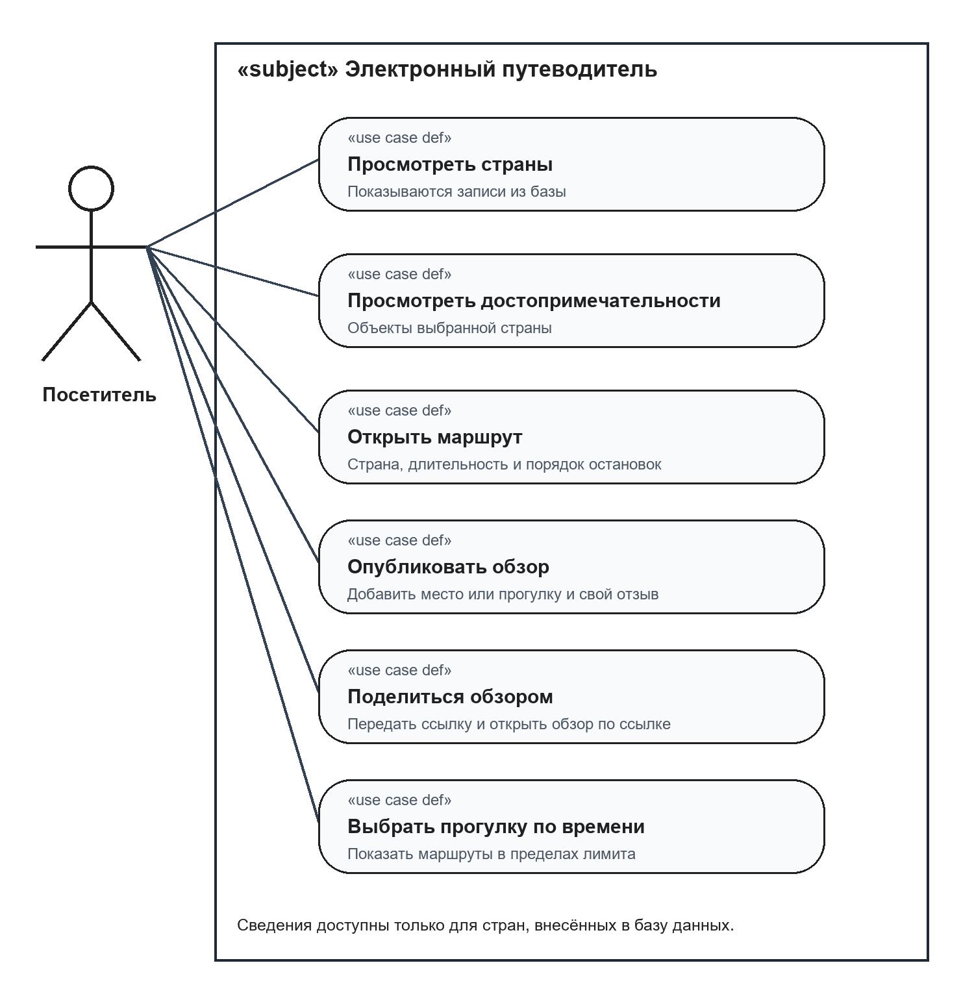
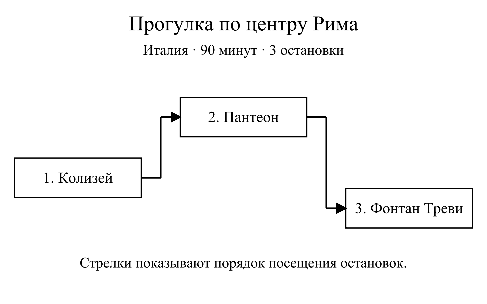
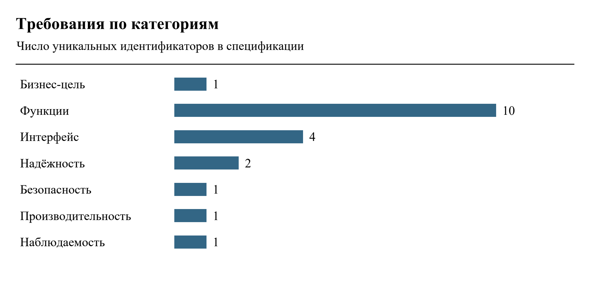
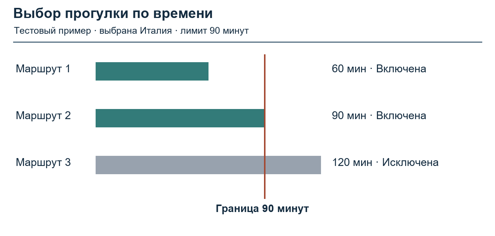

# Спецификация требований к ПО

Электронный путеводитель · Е. А. Юденко, группа 434701 · версия 0.7 от 27.11.2026

## Оглавление

- [1. Введение](#1-введение)
- [1.1 Назначение документа](#11-назначение-документа)
- [1.2 Область применения продукта](#12-область-применения-продукта)
- [1.3 Определения, акронимы и сокращения](#13-определения-акронимы-и-сокращения)
- [1.4 Ссылки](#14-ссылки)
- [1.5 Обзор документа](#15-обзор-документа)
- [2. Обзор продукта](#2-обзор-продукта)
- [2.1 Перспектива продукта](#21-перспектива-продукта)
- [2.2 Функции продукта](#22-функции-продукта)
- [2.3 Ограничения продукта](#23-ограничения-продукта)
- [2.4 Характеристики пользователей](#24-характеристики-пользователей)
- [2.5 Допущения и зависимости](#25-допущения-и-зависимости)
- [2.6 Распределение требований](#26-распределение-требований)
- [3. Требования](#3-требования)
- [3.1 Внешние интерфейсы](#31-внешние-интерфейсы)
- [3.2 Функциональные требования](#32-функциональные-требования)
- [3.3 Качество обслуживания](#33-качество-обслуживания)
- [3.4 Соответствие стандартам](#34-соответствие-стандартам)
- [3.5 Проектирование и реализация](#35-проектирование-и-реализация)
- [3.6 ИИ/МО](#36-иимо)
- [4. Верификация](#4-верификация)
- [5. Приложения](#5-приложения)

## История изменений

| Автор | Дата | Причина изменения | Версия |
|---|---|---|---|
| Е. А. Юденко | 05.11.2026 | Первичная фиксация темы, границ продукта и требований для обсуждения | 0.1 |
| Е. А. Юденко | 21.11.2026 | Синхронизация требований и критериев приёмки с разделом 3.1 отчёта | 0.2 |
| Е. А. Юденко | 21.11.2026 | Уточнены назначение и приоритеты первого выпуска по итоговому отчёту | 0.3 |
| Е. А. Юденко | 21.11.2026 | Добавлены обзоры посетителей, обмен ссылками, фильтр времени и планы по геолокации | 0.4 |
| Е. А. Юденко | 21.11.2026 | Восстановлены исходные четыре требования и критерии приёмки. Идеи развития перенесены в задачи проекта | 0.5 |
| Е. А. Юденко | 21.11.2026 | Структура разделов 2 и 3 приведена к шаблону кафедры | 0.6 |
| Е. А. Юденко | 27.11.2026 | Расширен реестр требований, добавлены проверки и графические приложения | 0.7 |

## 1. Введение

### 1.1 Назначение документа

Спецификация предназначена заказчику, разработчику и проверяющему. Она задаёт ожидаемое поведение и план приёмки.

### 1.2 Область применения продукта

Каталог может охватывать страны всего мира по мере наполнения базы. Посетители добавляют места и прогулки, публикуют отзывы и передают ссылки другим туристам. Для планирования прогулки читатель выбирает страну и доступное время.

### 1.3 Определения, акронимы и сокращения

| Термин | Значение |
|---|---|
| Страна | Запись каталога, содержащая название страны и связанные с ней достопримечательности и маршруты. |
| Достопримечательность | Объект интереса, относящийся к одной стране в базе данных. |
| Маршрут | Упорядоченный набор достопримечательностей, предлагаемый для посещения. Это определение подлежит подтверждению заказчиком. |
| Обзор | Опубликованный отзыв посетителя, связанный с конкретным местом или маршрутом и доступный по ссылке. |
| Длительность | Оценка автора в минутах, используемая при выборе прогулки. |
| База данных | Постоянное хранилище записей о странах, достопримечательностях и маршрутах; конкретная СУБД ещё не выбрана. |
| SRS | Спецификация требований к программному обеспечению. |
| SysML v2 | Язык моделирования систем, использованный для графической части работы. |

### 1.4 Ссылки

[Отчёт Word](../lab3/lab3.docx) · [Модель SysML v2](models/electronic-guide.sysml) · [Шаблон спецификации](srs-template.md).

### 1.5 Обзор документа

Раздел 2 описывает границы и очереди. Раздел 3 задаёт требования, раздел 4 связывает их с проверками. Раздел 5 содержит графические представления и словарь сущностей.

## 2. Обзор продукта

### 2.1 Перспектива продукта

«Электронный путеводитель» – настольное приложение на C++ для самостоятельных путешествий. Его главная особенность – каталог пополняют сами посетители. Турист добавляет место или маршрут, пишет отзыв о прогулке и делится им. Для следующего путешественника такой отзыв служит обзором места или маршрута.

### 2.2 Функции продукта

Турист выбирает страну, просматривает достопримечательности и остановки. Для развития запланированы собственные записи посетителей, отзывы со снимками, обмен ссылками и подбор по времени.

### 2.3 Ограничения продукта

В каталоге представлены страны и материалы, внесённые в базу. Длительность прогулки задаёт автор. Карты и геолокация относятся к следующему этапу.

### 2.4 Характеристики пользователей

Издатель определяет назначение каталога. Турист читает материалы, в планируемом расширении может быть автором обзора и получателем ссылки.

### 2.5 Допущения и зависимости

Просмотр существующего каталога опирается на локальную SQLite. Для открытия публикации на другом устройстве требуется доступный источник опубликованных обзоров.

### 2.6 Распределение требований

Основа – каталог и прогулки. Развитие – пользовательские материалы и подбор по времени. Следующий этап – карта. Пометка «Предложение» означает, что порог или способ работы предстоит согласовать.

- **ID:** BR-03
- **Title:** Самостоятельная прогулка
- **Statement:** Издателю необходимо расширить назначение путеводителя: читатель должен иметь возможность по материалам издания самостоятельно спланировать экскурсию по незнакомому городу.
- **Rationale:** Туристу проще решить, с чего начать знакомство с городом.
- **Acceptance Criteria:** Гость может назвать начало прогулки и объяснить, куда пойдёт дальше.
- **Verification Method:** Демонстрация
- **More Information:** Основа · Путеводитель

## 3. Требования

### 3.1 Внешние интерфейсы

#### 3.1.1 Пользовательские интерфейсы

- **ID:** REQ-INT-001
- **Title:** Контекст маршрута
- **Statement:** При просмотре маршрута пользователь должен одновременно видеть название прогулки и страну, к которой она относится.
- **Rationale:** Название страны помогает ориентироваться без возврата к началу поиска.
- **Acceptance Criteria:** При просмотре прогулки по Риму одновременно видны название маршрута и страна «Италия».
- **Verification Method:** Инспекция
- **More Information:** Основа · Карточка маршрута

- **ID:** REQ-INT-002
- **Title:** Пустая выборка
- **Statement:** При отсутствии маршрутов экран сообщает об этом и оставляет доступными места страны.
- **Rationale:** Пустой список прогулок не лишает туриста сведений о местах.
- **Acceptance Criteria:** Выбрать страну с одним местом без прогулок; видны место и пояснение об отсутствии маршрутов.
- **Verification Method:** Инспекция
- **More Information:** Основа · Каталог

- **ID:** REQ-INT-003
- **Title:** Длительность прогулки
- **Statement:** Карточка показывает оценку длительности в минутах.
- **Rationale:** Читатель понимает значение оценки и единицу измерения.
- **Acceptance Criteria:** Открыть прогулку с оценкой 90; на экране указано «90 минут».
- **Verification Method:** Инспекция
- **More Information:** Развитие · Карточка маршрута

#### 3.1.2 Аппаратные интерфейсы

Настольный клиент использует экран и обычные средства ввода. Требования к специализированным устройствам не установлены.

#### 3.1.3 Программные интерфейсы

Чтение стран, остановок и маршрутов выполняется из SQLite. Обмен опубликованными материалами проектируется отдельно.

### 3.2 Функциональные требования

- **ID:** REQ-FUNC-002
- **Title:** Смена страны
- **Statement:** При выборе страны программа должна обновить списки достопримечательностей и маршрутов. В обоих списках должны остаться только записи выбранной страны.
- **Rationale:** Турист видит, какие места можно посетить в выбранной стране и какие прогулки по ним уже подготовлены.
- **Acceptance Criteria:** После перехода с Италии на Беларусь в списках видны Верхний город и прогулка по центру Минска. Колизей и прогулка по центру Рима больше не отображаются.
- **Verification Method:** Тест
- **More Information:** Основа · Каталог

- **ID:** REQ-FUNC-001
- **Title:** Страны из базы
- **Statement:** Список стран формируется из записей каталога.
- **Rationale:** Редакция может расширять охват постепенно.
- **Acceptance Criteria:** Добавить запись страны в тестовую базу: после повторной загрузки она появляется в списке.
- **Verification Method:** Тест
- **More Information:** Основа · Каталог

- **ID:** REQ-FUNC-003
- **Title:** Порядок остановок
- **Statement:** Остановки выводятся по позиции в маршруте.
- **Rationale:** Порядок определяет план прогулки.
- **Acceptance Criteria:** Поменять местами вторую и третью позиции в базе. После загрузки экран отражает новый порядок.
- **Verification Method:** Тест
- **More Information:** Основа · Маршрут

- **ID:** REQ-FUNC-004
- **Title:** Описание места
- **Statement:** Выбор остановки открывает сведения связанной достопримечательности.
- **Rationale:** Туристу нужен контекст именно выбранной остановки.
- **Acceptance Criteria:** Для Пантеона и Колизея задать разные описания; при выборе каждой точки появляется соответствующий текст.
- **Verification Method:** Тест
- **More Information:** Основа · Карточка места

- **ID:** REQ-FUNC-005
- **Title:** Подбор по времени
- **Statement:** Фильтр оставляет прогулки выбранной страны длительностью не больше заданного лимита.
- **Rationale:** Посетитель может выбрать прогулку под доступное время.
- **Acceptance Criteria:** Для оценок 60, 90 и 120 минут при лимите 90 остаются первые две; прогулка другой страны исключена.
- **Verification Method:** Тест
- **More Information:** Развитие · Каталог

- **ID:** REQ-FUNC-006
- **Title:** Внесение материала
- **Statement:** Автор может создать описание места либо прогулки и привязать запись к стране.
- **Rationale:** Так посетители пополняют каталог собственными материалами.
- **Acceptance Criteria:** Создать по одной записи каждого типа и проверить страну и название обеих.
- **Verification Method:** Тест
- **More Information:** Развитие · Редактор

- **ID:** REQ-FUNC-007
- **Title:** Публикация отзыва
- **Statement:** Отзыв публикуется с привязкой к выбранному месту или маршруту.
- **Rationale:** Читателю важно понимать предмет отзыва.
- **Acceptance Criteria:** Создать одноимённые прогулки в двух странах; отзыв появляется только у выбранной записи.
- **Verification Method:** Тест
- **More Information:** Развитие · Редактор

- **ID:** REQ-FUNC-008
- **Title:** Фотографии
- **Statement:** Автор может добавить к отзыву несколько фотографий достопримечательности.
- **Rationale:** Снимки дополняют описание личным опытом.
- **Acceptance Criteria:** Прикрепить два разных снимка; после открытия публикации сверить оба изображения.
- **Verification Method:** Тест
- **More Information:** Развитие · Вложения

- **ID:** REQ-FUNC-009
- **Title:** Ссылка на обзор
- **Statement:** Получатель может открыть опубликованный обзор по переданной ссылке.
- **Rationale:** Это позволяет поделиться опытом за пределами каталога.
- **Acceptance Criteria:** Открыть ссылку в другом клиенте и сверить место, текст и набор фотографий.
- **Verification Method:** Тест
- **More Information:** Развитие · Обмен

- **ID:** REQ-FUNC-010
- **Title:** Метка объекта
- **Statement:** Автор может указать на карте положение описываемой достопримечательности.
- **Rationale:** Метка связывает обзор с конкретной точкой.
- **Acceptance Criteria:** Поставить метку в тестовой точке и повторно открыть объект: координаты совпадают с сохранёнными.
- **Verification Method:** Тест
- **More Information:** Следующий этап · Карта

### 3.3 Качество обслуживания

#### 3.3.1 Производительность

- **ID:** REQ-PERF-001
- **Title:** Время смены страны
- **Statement:** Предлагаемый порог обновления обоих списков – 2 с при 1000 местах и 100 маршрутах в локальной базе.
- **Rationale:** Условия измерения позволяют воспроизвести проверку.
- **Acceptance Criteria:** После прогрева выполнить 20 переключений на одном тестовом ПК; не менее 19 укладываются в 2 с. Записать конфигурацию и времена.
- **Verification Method:** Измерение
- **More Information:** Предложение · Каталог

#### 3.3.2 Безопасность

- **ID:** REQ-SEC-001
- **Title:** Разрешение геолокации
- **Statement:** Определение текущего положения запускается только с разрешения пользователя.
- **Rationale:** Турист контролирует использование своих координат.
- **Acceptance Criteria:** Отклонить разрешение: запрос координат не выполняется, ручной просмотр мест доступен.
- **Verification Method:** Тест
- **More Information:** Следующий этап · Карта

#### 3.3.3 Надёжность

- **ID:** REQ-REL-001
- **Title:** Сбой загрузки
- **Statement:** Если загрузить каталог полностью не удалось, программа должна сообщить об ошибке и исключить отображение неполных данных как полного каталога.
- **Rationale:** Гость понимает, можно ли доверять увиденному.
- **Acceptance Criteria:** При недоступной базе появляется сообщение об ошибке загрузки, частичные записи не выдаются за полный каталог.
- **Verification Method:** Тест
- **More Information:** Основа · Чтение базы

- **ID:** REQ-REL-002
- **Title:** Целостность публикации
- **Statement:** При сбое сохранения вложения неполный обзор остаётся недоступен читателю.
- **Rationale:** Автор и получатель должны видеть одну полную версию.
- **Acceptance Criteria:** Прервать сохранение второго снимка; открыть ссылку в другом клиенте и проверить отсутствие частичной публикации.
- **Verification Method:** Тест
- **More Information:** Развитие · Публикация

#### 3.3.4 Доступность

- **ID:** REQ-ACCESS-001
- **Title:** Выбор с клавиатуры
- **Statement:** Страну и маршрут можно выбрать с клавиатуры.
- **Rationale:** Основной сценарий доступен при отсутствии мыши.
- **Acceptance Criteria:** Пройти путь от списка стран до карточки маршрута клавишами Tab, стрелками и Enter.
- **Verification Method:** Демонстрация
- **More Information:** Предложение · Каталог

#### 3.3.5 Наблюдаемость

- **ID:** REQ-OBS-001
- **Title:** Диагностика ошибки
- **Statement:** При сбое чтения диагностическая запись различает недоступный файл и ошибку структуры базы.
- **Rationale:** Разработчик может выбрать способ восстановления по причине сбоя.
- **Acceptance Criteria:** Поочерёдно открыть отсутствующий и повреждённый файл; причины в диагностике различаются.
- **Verification Method:** Тест
- **More Information:** Предложение · Диагностика

### 3.4 Соответствие стандартам

Отчёт оформляется по СТП 01–2024 БГУИР. Для текстовых моделей используется SysML v2.

### 3.5 Проектирование и реализация

#### 3.5.1 Установка

Среда прототипа – Windows. Рядом с исполняемым файлом размещается база каталога.

#### 3.5.2 Сборка и поставка

Сборка C++ выполняется CMake. Инструкции доступны в каталоге project репозитория.

#### 3.5.3 Распределение

Основной каталог можно использовать локально. Для публикации и обмена нужен общий источник данных.

#### 3.5.4 Сопровождаемость

Данные маршрутов и порядок остановок хранятся отдельно от логики отображения.

#### 3.5.5 Повторное использование

Компонент доступа к каталогу используется при формировании списков и карточек.

#### 3.5.6 Переносимость

Поддержка иных ОС требует отдельного решения.

#### 3.5.7 Стоимость

Бюджет выпуска в рамках этой спецификации не утверждён.

#### 3.5.8 Сроки

Календарный план уточняется при проектировании.

#### 3.5.9 Доказательство концепции

Демонстрационный сценарий – смена страны, открытие маршрута и просмотр остановки.

#### 3.5.10 Управление изменениями

Изменение связывают с ID, критерием приёмки и редакцией в Git.

### 3.6 ИИ/МО

Использование ИИ и машинного обучения не предусмотрено.

## 4. Верификация

План верификации. Статус каждой строки – запланировано. Результаты испытаний в этой редакции не заявлены.

| ID | Сценарий приёмки | Метод | Очередь |
|---|---|---|---|
| BR-03 | Гость может назвать начало прогулки и объяснить, куда пойдёт дальше. | Демонстрация | Основа |
| REQ-FUNC-002 | После перехода с Италии на Беларусь в списках видны Верхний город и прогулка по центру Минска. Колизей и прогулка по центру Рима больше не отображаются. | Тест | Основа |
| REQ-REL-001 | При недоступной базе появляется сообщение об ошибке загрузки, частичные записи не выдаются за полный каталог. | Тест | Основа |
| REQ-INT-001 | При просмотре прогулки по Риму одновременно видны название маршрута и страна «Италия». | Инспекция | Основа |
| REQ-FUNC-001 | Добавить запись страны в тестовую базу: после повторной загрузки она появляется в списке. | Тест | Основа |
| REQ-FUNC-003 | Поменять местами вторую и третью позиции в базе. После загрузки экран отражает новый порядок. | Тест | Основа |
| REQ-FUNC-004 | Для Пантеона и Колизея задать разные описания; при выборе каждой точки появляется соответствующий текст. | Тест | Основа |
| REQ-FUNC-005 | Для оценок 60, 90 и 120 минут при лимите 90 остаются первые две; прогулка другой страны исключена. | Тест | Развитие |
| REQ-FUNC-006 | Создать по одной записи каждого типа и проверить страну и название обеих. | Тест | Развитие |
| REQ-FUNC-007 | Создать одноимённые прогулки в двух странах; отзыв появляется только у выбранной записи. | Тест | Развитие |
| REQ-FUNC-008 | Прикрепить два разных снимка; после открытия публикации сверить оба изображения. | Тест | Развитие |
| REQ-FUNC-009 | Открыть ссылку в другом клиенте и сверить место, текст и набор фотографий. | Тест | Развитие |
| REQ-INT-002 | Выбрать страну с одним местом без прогулок; видны место и пояснение об отсутствии маршрутов. | Инспекция | Основа |
| REQ-INT-003 | Открыть прогулку с оценкой 90; на экране указано «90 минут». | Инспекция | Развитие |
| REQ-REL-002 | Прервать сохранение второго снимка; открыть ссылку в другом клиенте и проверить отсутствие частичной публикации. | Тест | Развитие |
| REQ-SEC-001 | Отклонить разрешение: запрос координат не выполняется, ручной просмотр мест доступен. | Тест | Следующий этап |
| REQ-FUNC-010 | Поставить метку в тестовой точке и повторно открыть объект: координаты совпадают с сохранёнными. | Тест | Следующий этап |
| REQ-ACCESS-001 | Пройти путь от списка стран до карточки маршрута клавишами Tab, стрелками и Enter. | Демонстрация | Предложение |
| REQ-PERF-001 | После прогрева выполнить 20 переключений на одном тестовом ПК; не менее 19 укладываются в 2 с. Записать конфигурацию и времена. | Измерение | Предложение |
| REQ-OBS-001 | Поочерёдно открыть отсутствующий и повреждённый файл; причины в диагностике различаются. | Тест | Предложение |

## 5. Приложения

### 5.1 Контекст и сценарии

Рисунок 4.1 – Контекст просмотра маршрута

Рисунок 5.3 – Варианты использования

### 5.2 Макеты и аналитические диаграммы

#### Каталог

Рисунок 5.8 – Выбор страны и прогулки

#### Маршрут

Рисунок 5.9 – Карточка и схема маршрута

#### Редактор отзыва

Рисунок 5.12 – Редактор отзыва с фотографиями

#### Распределение требований

Рисунок 5.1 – Распределение требований по категориям

#### Граница фильтра времени

Рисунок 5.6 – Граничные случаи фильтра времени

#### Связи сущностей

Рисунок 5.5 – Связи сущностей каталога

#### Карточка места

Рисунок 5.10 – Карточка выбранной остановки

#### Сбой чтения каталога

Рисунок 5.11 – Ошибка открытия базы

#### Обзор по ссылке

Рисунок 5.13 – Чтение обзора по ссылке

### 5.3 Словарь сущностей

| Сущность | Смысл | Связь |
|---|---|---|
| Страна | Направление | Объединяет места и маршруты |
| Остановка | Позиция внутри маршрута | Ссылается на место |
| Обзор | Опубликованный отзыв | Относится к месту или маршруту |
| Вложение | Снимок автора | Принадлежит отзыву |
